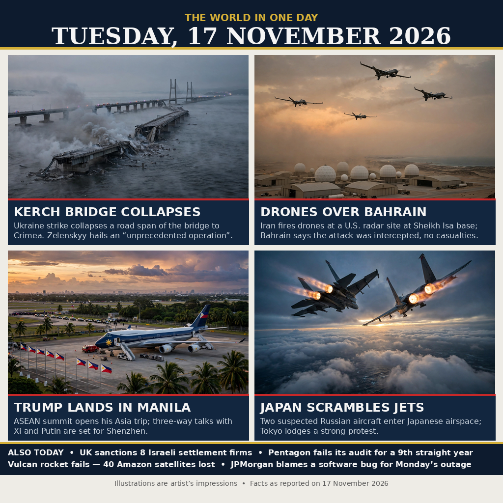

[](https://make.fun/c/news-image-20261117)

# The World in One Day — Tuesday, 17 November 2026

Entry for the make.fun competition
[news-image-20261117](https://make.fun/c/news-image-20261117):
sum up 17 November 2026's world news in one image.



## What the image shows

A newspaper front page for Tuesday, 17 November 2026, built from four
illustrated panels plus a ticker of further stories from the same day:

1. **Kerch Bridge collapses** — a Ukrainian strike brings down a road
   span of the bridge to Crimea; President Zelenskyy called it
   "an unprecedented operation".
2. **Drones over Bahrain** — Iran fires drones at a U.S. radar site at
   Sheikh Isa base; Bahrain says the attack was intercepted, with no
   casualties reported.
3. **Trump lands in Manila** — the ASEAN summit opens his Asia trip;
   three-way talks with Xi Jinping and Vladimir Putin are set for
   Shenzhen.
4. **Japan scrambles jets** — two suspected Russian aircraft enter
   Japanese airspace; Tokyo lodges a strong protest.

Also today: the UK sanctions eight Israeli settlement firms; the
Pentagon fails its financial audit for a ninth straight year; a ULA
Vulcan rocket fails, destroying 40 Amazon Leo satellites; JPMorgan
blames a software bug for Monday's banking outage.

The four panels are artist's impressions, drawn from the reported
events; every fact and figure in the captions was checked against
news reported on 17 November 2026 (BBC, AP, Reuters, Just Security).

## How it is built

`main.ts` (Node 22, standard library only) copies the composed
`entry.png` to `$MAKEFUN_OUTPUT_DIR/entry.png`. It runs with no
network and writes identical bytes on every run. The front page
itself was composed offline from the four panels with a real font,
so all text in the image is crisp and correct.

Run it locally:

```sh
mkdir -p out && MAKEFUN_OUTPUT_DIR=out node main.ts
```

## License

MIT — see [LICENSE](LICENSE).
